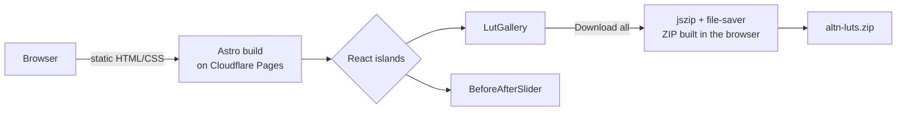

# altn: LUT site

Website for the **altn LUT pack**: 33 self-authored colour grading LUTs for trekking and drone footage, plus 2 utility LUTs. Browse the looks, compare them with a before/after slider, and download one LUT or all of them, with nothing to sign up for.

This is the redesigned site. It merges the production site with the experimental features from the original [Altnweb](https://github.com/AaryanRaj007/Altnweb) repo, which also holds the LUT sources and the DaVinci Resolve plugin.

## Pages

| Route | What's there |
|---|---|
| `/` | Landing page and featured looks |
| `/luts` | Gallery of all creative LUTs, grouped by collection |
| `/utility` | Log-normalisation LUTs for Apple Log and DJI D-Log |
| `/plugins` | DaVinci Resolve plugin: YouTube Media Importer |
| `/about` | Story and workflow, written in MDX |

## How it works



- **Astro, with static output**: pages ship no JavaScript by default.
- **React islands**: only the gallery, the slider and the animated backgrounds hydrate.
- **No backend**: the batch download is zipped in the browser, so hosting costs nothing.
- **Before/after slider**: a native `<input type="range">` driving a CSS `clip-path`, with no slider library.

## Stack

Astro 5 · React · Tailwind CSS v4 · Motion · Radix navigation menu · MDX · lucide icons

## Run locally

```bash
npm install
npm run dev       # http://localhost:4321
npm run build     # static site in dist/
npm run preview   # serve the build
```

## Project layout

```
src/
  pages/        index, luts, utility, plugins, about
  components/   layout, footer, ui/ (gallery, slider, backgrounds, nav)
  content/      about.mdx
  config/       site.ts (name, GitHub links)
public/         LUT files and preview images
```

## Licence

[MIT](LICENSE)
